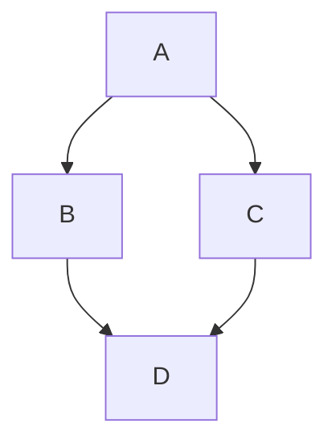

# Introduction

Research software tools, combined in computational workflows, are essential to modern, data-driven, life science. While resources such as InSoLito [REF] provides a network of co-citations of papers associated with software tools, Galaxy [REF] provides a tool recommender based on existing workflows, and Workflowmics [REF] explores new workflows based on annotations in bio.tools [REF], no effort have been so far been made to capture the order of tool citations and compare this with actual, directed, interoperability of tools in workflows. In this project, we bridged ordered citations from the Open Access literature in Europe PMC [REF] with Galaxy, Nextflow [REF] and Snakemake [REF] workflows, using research software annotated and associated with publications in bio.tools to predict tool interoperability from co-citations and visualize relationships between bioinformatics tools used in workflows, focusing on three main goals:

Goal 1: Constructing a directed network of software tool co-citations. By analyzing the order in which publications associated with bio.tools entries are cited in open-access scientific articles, we infer potential relationships between tools. Unlike conventional undirected co-citation networks, the resulting graph captures citation order and distances, providing information about the sequence in which tools are likely used in computational analyses.

Goal 2: Comparing literature-derived relationships with computational workflows with the latter as ground-truth for the validation of the former. Specifically, we explore aim to extract tool dependencies and execution order from workflows deposited in WorkflowHub, including Galaxy and Nextflow workflows, and compare these with relationships inferred from the literature. This will allow us to investigate whether citation order can predict the direction of tool dependencies in actual workflows, and how predictive performance depends on the strength and consistency of co-citation patterns.

Integrating directed tool relationships into InSoLiTo. Finally, we aim to extend InSoLiTo, an existing platform for exploring relationships between life science software tools through publication co-citations, with the newly constructed directed network. This will enable users to explore not only which tools are frequently cited together, but also potential directional relationships between them, providing a foundation for future applications such as software recommendation and workflow design.

## Meeting information

If you want to submit a preprint to BioHackrXiv, first check if your meeting is registered. You can find a list
of meetings [here](https://index.biohackrxiv.org/meetings). If your meeting is missing, please contact your meeting
organizers. The above list also provides information on the YAML fields with information about the meeting.

The following fields need to be given:

```YAML
biohackathon_name: "BioHackathon Europe 2026"
biohackathon_url:   "https://biohackathon-europe.org/"
biohackathon_location: "Barcelona, Spain, 2026"
group: Project 26
git_url: https://github.com/inab/biohackathon2026-paper-project-17
```

The [BioHackrXiv meeting pages](https://index.biohackrxiv.org/meetings) provide content to use for the first
three fields. The `git_url:` field must have the link to the GitHub repository with your preprint (draft).

## Author information

Information about the authors is given in the [YAML](https://en.wikipedia.org/wiki/YAML) format at the top of this template.
For authors you provide their names, their affiliations. That is the minimum, but as BioHackrXiv is moving to a situation
where more metadata is shared, and used by, for example, EuropePMC, adding additional information ie encouraged.

BioHackathons is about hacking together, and the minimal number of authors for reports is two. This makes a minimal example
look like this:

```yaml
authors:
  - name: First Author
    affiliation: 1
  - name: Last Author
    affiliation: 2
affiliations:
  - name: First Affiliation
    index: 1
  - name: ELIXIR Europe
    index: 2
```

### Author identifiers

Ideally, authors provide their [ORCID](https://orcid.org/) identifier. For affiliations, It is added with the `orcid:` field.
So, and author record would look like this:

```yaml
authors:
  - name: First Author
    affiliation: 1
    orcid: 0000-0000-0000-0000
```

### Research Organization Registry identifiers

Matching the author identifier, the affiliations can be further specified with the
[Research Organization Registry](https://ror.org/) (ROR) identifier.
For example, this is the affiliation identifier can be added with the `ror:` field:

```yaml
affiliations:
  - name: ELIXIR Europe
    ror: 044rwnt51
    index: 2
```

### Contributor Role Taxonomy

A last feature since is minimal support for the Contributor Role Taxonomy (CRediT). You
can specify the role of authors in writing the report with the `role:` field. However,
the authors are responsible for selection the right terms from [CRediT](https://credit.niso.org/).
An example looks like this:

```yaml
authors:
  - name: First Author
    affiliation: 1
    orcid: 0000-0000-0000-0000
    role: Conceptualization, Writing – review & editing
```

### A full examples

A full example then has this structure:

```yaml
authors:
  - name: First Author
    affiliation: 1
    role: Writing – original draft
  - name: Last Author
    orcid: 0000-0000-0000-0000
    affiliation: 2
    role: Conceptualization, Writing – review & editing
affiliations:
  - name: First Affiliation
    index: 1
  - name: ELIXIR Europe
    ror: 044rwnt51
    index: 2
```

# Formatting

This document use Markdown and you can look at [this tutorial](https://www.markdowntutorial.com/).

## Subsection level 2

Please keep sections to a maximum of only two levels.

## Tables

Tables can be added in the following way, though alternatives are possible:

```markdown
Table: Note that table caption is automatically numbered and should be
given before the table itself.

| Header 1 | Header 2 |
| -------- | -------- |
| item 1 | item 2 |
| item 3 | item 4 |
```

This gives:

Table: Note that table caption is automatically numbered and should be
given before the table itself.

| Header 1 | Header 2 |
| -------- | -------- |
| item 1 | item 2 |
| item 3 | item 4 |

## Figures

A figure is added with:

```markdown

```

This gives:


Figures can be scaled by adding the width or height to the Markdown like this:

```markdown
{ width=50px }
```

You can add cross references to figures by adding a LaTeX `\label{figureCode}` to
the label of the Markdown figure and then use `\ref{figureCode}` to cite it:

```markdown
{ width=50px }
```

This way, we can cite Figure \ref{figureCode}.

## Mermaid graphs

[Mermaid](https://mermaid.js.org/) provides a solution to put diagrams in Markdown. BioHackrXiv
added support for this in 2026. This is an example of embedding a graph:



# Other main section on your manuscript level 1

Lists can be added with:

1. Item 1
2. Item 2

# Citation Typing Ontology annotation

You can use [CiTO](http://purl.org/spar/cito/2018-02-12) annotations, as explained in [this BioHackathon Europe 2021 write up](https://raw.githubusercontent.com/biohackrxiv/bhxiv-metadata/main/doc/elixir_biohackathon2021/paper.md) and [this CiTO Pilot](https://www.biomedcentral.com/collections/cito).
Using this template, you can cite an article and indicate _why_ you cite that article, for instance DisGeNET-RDF [@citesAsAuthority:Queralt2016].

The syntax in Markdown is as follows: a single intention annotation looks like
`[@usesMethodIn:Krewinkel2017]`; two or more intentions are separated
with colons, like `[@extends:discusses:Nielsen2017Scholia]`. When you cite two
different articles, you use this syntax: `[@citesAsDataSource:Ammar2022ETL; @citesAsDataSource:Arend2022BioHackEU22]`.

Possible CiTO typing annotation include:

* citesAsDataSource: when you point the reader to a source of data which may explain a claim
* usesDataFrom: when you reuse somehow (and elaborate on) the data in the cited entity
* usesMethodIn
* citesAsAuthority
* citesAsEvidence
* citesAsPotentialSolution
* citesAsRecommendedReading
* citesAsRelated
* citesAsSourceDocument
* citesForInformation
* confirms
* documents
* providesDataFor
* obtainsSupportFrom
* discusses
* extends
* agreesWith
* disagreesWith
* updates

There is a general `cites` intention, but this is already implied and should be left out.

# Results


# Discussion

...

## Acknowledgements

...

# References

```{=latex}
\AtEndDocument{%
```

# Appendices

If you want the Appendix (-ces) to show up after the references, wrap them in 
after the header, like done in this Markdown file. Look at the [source](paper.md)
to see the exact structure.

```{=latex}
}
```
